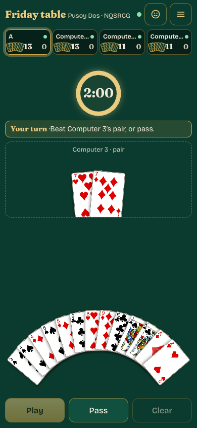
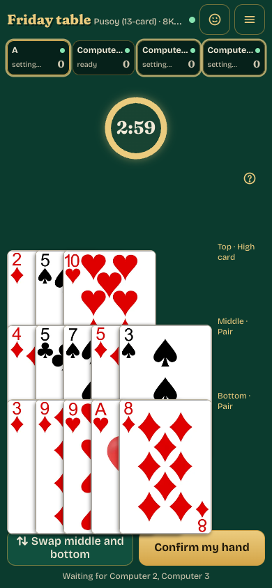
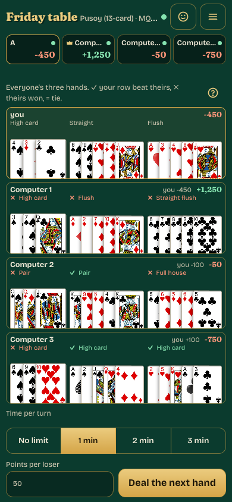

# TableTally

**[Play TableTally in your browser](https://tabletally.tabletally.workers.dev)** — free, no account or download needed.

Card games with friends, on your phones. The host starts a table and picks the game; everyone else joins by scanning a QR code or typing a six-letter code. The app shuffles, deals, checks every play and keeps the score live on every phone. No accounts, no email, and you keep your seat after a refresh or a dropped connection.

| Pusoy Dos | Pusoy | After a Pusoy hand |
|---|---|---|
|  |  |  |

## How to play

1. Open **[TableTally](https://tabletally.tabletally.workers.dev)** on your phone or computer and choose **Start a table**.
2. Pick Pusoy Dos, Pusoy, Tong-its or Poker, set the player count and table options, enter your display name, then choose **Create table**.
3. Invite friends by sharing the table link or letting them scan its QR code. They can also open the app, choose **Join a table** and enter the six-letter table code. Each friend enters a display name and taps **Sit down**.
4. Once every seat is filled, the host picks a time per turn (No limit, 1, 2 or 3 minutes) and taps **Deal**. Play your cards in the app; it checks the moves, keeps everyone's cards private and records the score automatically.
5. After the hand, review the results. The host taps **Deal the next hand** to keep playing.

**Playing solo?** Add computer players when creating the table. Choose Easy, Normal or Hard to fill the other seats, then deal.

Everyone needs an internet connection. Friends should join before the first hand starts. Keep using the same browser to return to your seat after a refresh or disconnect. If you host, save the host key shown when you create the table so you can reclaim your seat from another phone.

## Scores only, never money

**TableTally only keeps score.** It never handles, holds or transfers money, never connects to a payment service, and has no real-money betting. Poker uses play chips: they are a score, nothing is wagered, held or moved. Totals are numbers in the table's unit, either points or a currency label you choose (for example PHP). If you play for stakes, you are responsible for following the laws where you live.

## Games

- **Pusoy Dos** (2 to 4 players): winner takes all by default; optional penalties for cards left, play until one remains, and a multiplier for 2s.
- **Pusoy**, 13-card Chinese poker (2 to 4): everyone sets top, middle and bottom rows in secret; 2-4 or 1-6 points, royalties and naturals. After every hand everyone sees everyone's rows, marked won or lost against their own.
- **Tong-its** (3): Tongits Go style payments by default, always with a pot; Pagat's amounts as an option.
- **Poker** (2 to 6): no-limit Texas Hold'em with play chips; stacks carry from hand to hand.

Fill any empty seat with a computer player (Easy, Normal or Hard), or play alone against three. How each game is played and scored, with worked examples, is in [`docs/rules/`](docs/rules).

## What else

- Cards drawn from a public-domain deck and held like a real hand.
- The host can void the last hand (and bring it back), hand the host role to someone else, and get back in on a new phone with the host key shown when the table was made.
- Exact whole-number arithmetic everywhere. Totals always add up to zero.
- English and Filipino. The Filipino text has not yet been checked by a native speaker; corrections are welcome.
- Installable on a phone's home screen. You need a connection to play.
- Dark "Manila night table" design; motion respects reduced-motion settings; sound is off until you turn it on.

## Privacy

The server keeps the table, the players' display names, the hand history and the hand being played. Each phone is sent only its own cards. A phone is recognised by a random token, and the server keeps only a hash of it. Tables are deleted 24 hours after the last activity (the host can keep one for 30 days). No tracking, no ads, no analytics.

## Run it locally

Needs Node.js 22.12 or newer.

```
npm install
npm run build          # builds dist/, which the Worker serves
npm run dev:worker     # http://localhost:8787
```

For front-end work, run `npm run dev` (Vite on :5173, proxying `/api` and WebSockets to :8787) next to `npm run dev:worker`.

```
npm test               # unit tests
npm run typecheck
npm run lint           # house rules and the English/Filipino check
npm run smoke          # end-to-end checks against a running `npm run dev:worker`
```

## How it is built

Cloudflare Workers and Durable Objects (one Durable Object per table, SQLite storage, hibernating WebSockets), Svelte 5 and TypeScript, all on Cloudflare's free plan. The server is the only writer: phones send moves, the table checks them with the game's engine, and every phone gets its own view back. Each game is a scoring module plus an engine; see [`CONTRIBUTING.md`](CONTRIBUTING.md) to add one.

## Deploy

```
npm run build
npx wrangler login
npx wrangler deploy
```

The Durable Object migration is already in `wrangler.jsonc`. Durable Objects with SQLite are available on the Workers free plan.

## License

[MIT](LICENSE). Third-party libraries, fonts and images are listed in [`ASSETS.md`](ASSETS.md).
