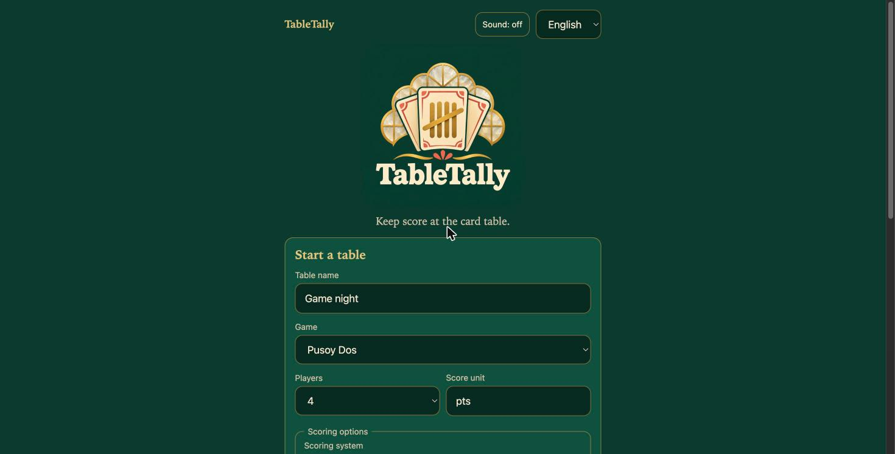
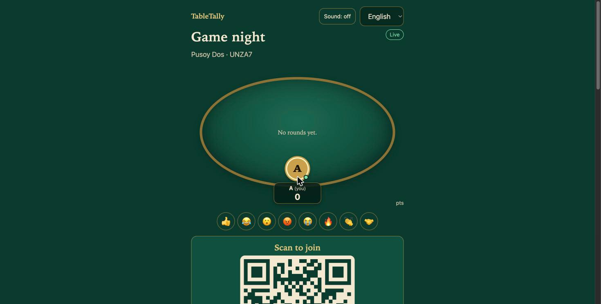

# TableTally

An open-source score tracker for card games among friends at one table. The host creates a room and picks the game, and everyone else joins by scanning a QR code (or typing a short room code) on their phone. No accounts, no email. A player keeps their identity after a refresh or a dropped connection. Everyone sees the running score live.

| Start a table | The table |
|---|---|
|  |  |

## Score tracker only

**TableTally only keeps score.** It never handles, holds or transfers money, never connects to a payment service, and has no real-money betting. (Poker played in the app uses play chips only: they are a score, nothing is wagered, and nothing is held or moved.) Totals are numbers in the room's unit: points, or a currency label you choose (for example PHP). If you play for stakes, you are responsible for following the laws where you live.

## Games

- **Pusoy Dos**: winner takes all (the default), or optional penalties for cards left, or play until one player remains. Optional deuce (2) multiplier. Private hand helper that finds the fewest plays.
- **Pusoy** (13-card Chinese poker): row-by-row scoring, fouls, optional royalties and naturals.
- **Tong-its**: Tongits Go style by default with a pot, plus group variations as host options. Private hand helper.
- **Poker** (home cash game): played in the app as no-limit Texas Hold'em with play chips, or you enter buy-ins, rebuys and cash-outs in chips (never hands or pots), totals come out in the room's unit through your chip ratio, and it flags any mismatch between chips in and chips out.

Rules, sources and worked examples are in [`docs/rules/`](docs/rules). Points a source does not settle are marked unverified there.

## Features

- **Play in the app** (all four games): the app shuffles, deals and runs the turns on everyone's phone. Play solo or fill empty seats with computer players at Easy, Normal or Hard.
- Change your name any time (the host can also rename computers and players it added).
- Live scores over WebSockets, with undo and edit-with-reason, and a full round history.
- Exact integer math only. Totals always add up to zero.
- English and Filipino.
- Installable (PWA). The service worker caches the app shell only, so editing needs a connection.
- Dark "Manila night table" theme; motion respects `prefers-reduced-motion`; sound is off by default.
- With real cards, hands stay on the player's own phone and the server never sees them. When you play in the app, the server deals and holds the hands (each phone is sent only its own cards) and deletes them with the room.

## Privacy

Minimal stored data: the room, its players' display names and its round log (plus, in tables played in the app, the hand being played). A device is recognised by a random token, and the server keeps only its SHA-256. Rooms are deleted automatically 24 hours after the last activity (the host can extend this to 30 days). No tracking, no ads, no analytics.

## Run it locally

```
npm install
npm run build          # builds dist/, which the Worker serves
npm run dev:worker     # http://localhost:8787
```

For front-end work run `npm run dev` (Vite on :5173, proxying `/api` and WebSockets to :8787) next to `npm run dev:worker`.

```
npm test               # unit tests
npm run typecheck
npm run smoke          # end-to-end checks against a running `wrangler dev`
```

## How it is built

Cloudflare Workers + Durable Objects (one Durable Object per room, SQLite storage, hibernating WebSockets), Svelte 5 and TypeScript, all on Cloudflare's free tier. A shared core handles rooms, the ledger and settlement helpers; each game is one module. See [`CONTRIBUTING.md`](CONTRIBUTING.md) to add a game.

## Deploy

```
npm run build
npx wrangler login
npx wrangler deploy
```

The Durable Object migration is already in `wrangler.jsonc`. Durable Objects with SQLite are available on the Workers free plan.

## License

[MIT](LICENSE). Third-party libraries and images are listed in [`ASSETS.md`](ASSETS.md).
